# mg-node（my-git-note）开发技术文档

> 版本 v0.1 · 2026-11-03 · 作者：Davin · 状态：设计稿（未开发）


## 1. 产品概述与目标

mg-node 是一款 macOS 个人笔记工具。笔记全部存放在用户**自己的 GitHub / Gitee 私有仓库**。它的目标是：

- **数据自主**：笔记就是仓库里的 Markdown 和文件，不依赖任何第三方云服务，随时可以 `git clone` 带走。
- **一处编辑多种格式**：MD、HTML 可以编辑；DOCX、PPTX、PDF 可以查看和批注，必要时编辑。
- **一键同步**：拉取、提交、推送一个按钮完成，冲突可视化。
- **单篇公开**：开关一打开就发布成网页并给出链接；关掉就归档回私有仓库。
- **随手收集**：浏览器插件把网页、选中内容或截图存进「收集笔记」。

### 1.1 范围

| 能力 | MVP（M1–M3） | 后续 |
|---|---|---|
| 账号 | GitHub 登录、Gitee 登录、选择或新建私有仓库 | 多账号、多仓库切换 |
| 编辑 | MD 三种模式、HTML 源码与预览 | 所见即所得、表格编辑器、Mermaid |
| 文档 | PDF 查看与批注、DOCX/PPTX 只读预览 | DOCX/PPTX 内嵌编辑（OnlyOffice） |
| 同步 | 手动同步、定时自动同步、冲突解决 | 选择性同步、LFS 管理界面 |
| 公开 | GitHub Pages 单篇发布、取消公开并归档 | 自定义域名、国内静态托管 |
| 插件 | Chrome 剪藏（整页、选中、截图） | Safari、Firefox |
| 个性化 | 10 个手绘 SVG 头像、3 种头像形状、6 种主题色、3 种外观、手写字体、登录插画、昵称 | 上传并裁剪头像、暗色模式 |
| 编辑体验 | WPS 风格工具栏、斜杠命令、⌥↩ 意图操作、命令面板 | 自定义意图插件 |
| AI 助手（M5，默认关闭） | 自带 Key、引用问答、总结、周报 | 本地 OCR、多轮 Agent |

## 2. 总体架构

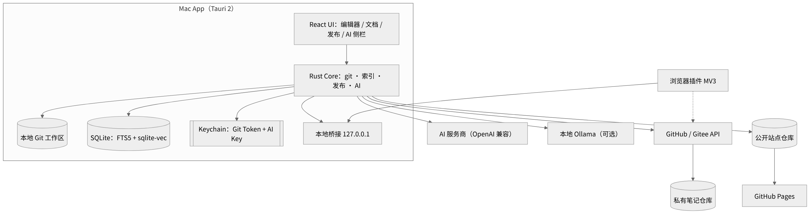

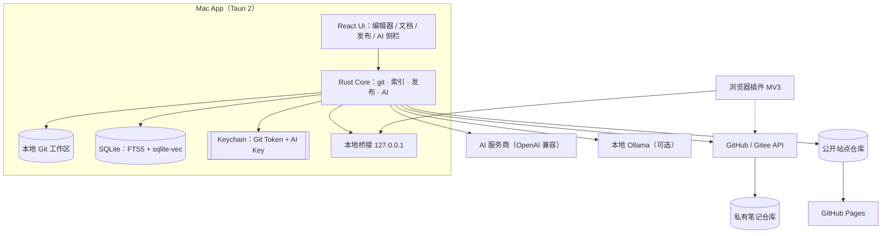

连线说明：插件优先通过本地桥接写入，Mac 应用没运行时用虚线所示的 Contents API 直推；Core 与平台之间走 HTTPS（git 和 REST）；向公开站点仓库推送的是构建好的静态页；AI 调用只发送检索到的片段。

要点：

- 所有 git 操作都在 Rust 侧完成，UI 只通过 Tauri command 和 event 调用。
- 私有笔记仓库与公开站点仓库**物理分开**。GitHub Pages 要从私有仓库发布需要付费套餐，而且分开可以保证私有内容不会被误公开。

## 3. 技术选型

| 领域 | 选型 | 理由 / 取舍 |
|---|---|---|
| 桌面壳 | **Tauri 2** + React 18 + TypeScript + Vite | 包体约 10 MB，内存低，Rust 侧便于接 git2 和 Keychain。备选 Electron：生态成熟、调试方便，但包体超过 100 MB；如果 DOCX/PPTX 需要大量 Node 库，可以改用 Electron |
| Git | **git2-rs（libgit2）** | 性能好，支持 SSH/HTTPS、merge 和 diff。isomorphic-git 是纯 JS，大仓库慢、LFS 要自己实现，只在浏览器插件或 Electron 方案里考虑 |
| MD 编辑 | **CodeMirror 6** | 增量解析、大文件性能好、扩展多（行号、高亮、快捷键） |
| MD 预览 | **markdown-it** + highlight.js + markdown-it-task-lists | 比 remark 更快，适合实时预览；导出静态站时用 unified/remark 做 AST 级处理（目录、链接改写） |
| PDF | **PDF.js** | 渲染和文本层成熟，批注叠加层自己绘制 |
| DOCX | 查看：**docx-preview** 渲染成 HTML；编辑：「用外部应用打开」（Word/Pages/WPS），保存后监听文件变化回写，后续再评估 OnlyOffice 嵌入 | 如实说明：纯前端无法高保真编辑 DOCX；内嵌 OnlyOffice 需要本地起 Document Server（重，有 AGPL 许可问题） |
| PPTX | 查看：LibreOffice headless 把 PPTX 转成 PDF（可选安装）后用 PDF.js 显示；或用 pptx-preview 轻量渲染；编辑：外部应用往返 | 同上。高保真渲染依赖 LibreOffice（约 300 MB），作为可选组件 |
| 索引/搜索 | **SQLite + FTS5**（rusqlite），中文用 jieba-rs 分词后入库 | 本地、离线、快 |
| 凭据 | **macOS Keychain**（keyring crate） | 不落盘明文 |
| 插件 | Manifest V3 + TypeScript + Vite（crxjs） | Chrome/Edge 通用 |

## 4. 登录页视觉设计与登录流程


> **设计来源**：本章按 Davin 的设计项目 `git-note-tool-design`（`LoginScreen.tsx` / `CustomizePanel.tsx` / `settings.tsx` / `Avatar.tsx` / `art.ts`）同步，插画直接用该项目的 `login-anime.jpg`、`login-cat.jpg`、`login-plants.jpg`。和之前版本冲突的地方都按他的设计改，并在下面用「⚠ 变更」标出。

### 4.1 布局
- 登录窗口固定为 1152×640（Mac 窗口外壳，标题「mg-node — 登录」），**左右两栏，宽度比 1.05 : 1**，左边插画，右边登录表单。
  - ⚠ 变更：之前是插画占 62% 的全屏布局，现在改为他的两栏布局。
- **左栏插画区**：
  - 底色 `#f6efe2`，插画 `object-fit: cover` 铺满。
  - 底部叠一层暖纸色渐变遮罩 `linear-gradient(to top, rgba(246,239,226,.95) 0%, rgba(246,239,226,0) 38%)`，保证文字可读。
  - 左上角是 Logo：白底「mg」手绘描边方块（`.sketch-border`，不规则圆角，墨色 `#3b342c`），旁边一块白色名牌，写「mg-node」和「my-git-note · 自有笔记工具」。
  - 底部是**手写字体的标语**（28px，ZCOOL KuaiLe），每张插画一句。
  - 标语下方一行控件：‹ 上一张、圆点（当前那颗变成 24px 的长条）、下一张 ›，最后是插画名。
- **插画与标语**（来自 `art.ts`）：

| id | 名称 | 标语 |
|---|---|---|
| anime | 少女与植物 | 把每一个念头，种进你的笔记花园 |
| cat | 猫与龟背竹 | 写下今天，晒晒太阳，慢慢生长 |
| plants | 窗边花园 | 笔记像植物，需要时间和照料 |

- 切换插画就是修改个性化设置里的 `loginArt`，会被持久化，下次打开显示同一张。原型里每 6 秒自动切到下一张，个性化面板打开时暂停；他的项目里只能手动切换。
- ⚠ 变更：之前的主标语「笔记归你，仓库也归你 · 永久免费」不再显示在登录页，改为每张插画各配一句手写标语。原标语保留，用于官网和关于页。
- 风格仍然是手绘彩铅加水彩，角色和植物为主，不使用日式建筑元素。

### 4.2 登录表单（右栏）
- 右上角是胶囊按钮「🎨 个性化」，点击后在表单上方浮出个性化面板（宽 360px，标题「个性化设置」，可以滚动，内容见第 6 章，**包含登录页插画选项**）。
- **问候**：46px 的当前头像，加手写字体标题「你好，{昵称} ~」（没有昵称时显示「朋友」）。副标题是「登录并连接你的私密笔记仓库 `my-git-note`」。
  - ⚠ 变更：原标题「登录并连接笔记仓库」改为这句问候。
- **服务商卡片**（两列）：
  - GitHub：黑底分支图标，副标题「海外 · GitHub Pages」。
  - Gitee：红底「G」，副标题「国内 · Gitee Pages」。
  - 选中的卡片用 `accent-500` 描边，加 `accent-100` 外圈和淡色底。
  - ⚠ 冲突说明：他的设计写的是「Gitee Pages」，但 **Gitee Pages 已经下线**（已核实）。所以界面上保留他的文案，旁边加一个 ⓘ 提示：「Gitee 只做私有存储，公开发布走 GitHub Pages」。
- **登录方式切换**：「授权登录(推荐)」和「访问令牌 Token」。
  - 授权登录：显示「将打开浏览器完成 OAuth 授权(Device Flow)，授权范围：repo(私有仓库读写)」。
  - Token：带 🔑 图标的密码框，占位文字「粘贴 {服务商} Personal Access Token」，下方说明「🔒 令牌仅保存在 macOS 钥匙串(Keychain)中」。
  - 鉴权的实现仍按第 5 章：GitHub App + Device Flow；Gitee 走 OAuth 或私人令牌。
- **主按钮**：主题色 `accent-600`（hover 时 `accent-700`），圆角 12px，文案「使用 {GitHub|Gitee} 登录」。点击后进入加载状态「◌ 正在连接 {服务商} 并拉取笔记…」，约 1.2 秒后进入选择仓库。
- 底部小字：「头像、主题与插画可点右上角「个性化」随时更换」。
- 登录前就能设置个性化：设置保存在本机，登录后跟随账号（见第 6 章的存储说明）。

### 4.3 选择仓库


1. 授权成功后，用 `GET /user/repos?affiliation=owner&per_page=100`（Gitee 用 `/v5/user/repos`）分页拉取仓库列表，支持本地搜索，显示 🔒 私有 / 🌐 公开标记和更新时间。
2. **笔记仓库（必选）**：只能选私有仓库，公开仓库灰显并提示「公开仓库不能作为笔记仓库」。列表第一项是「＋ 新建私有仓库 my-git-note」（名称可改，重名时自动加后缀）；新建后自动写入目录骨架和 `.mgnote/config.json`。
   - 选择已有仓库时，检查里面有没有 `.mgnote/`：没有就提示「将在该仓库中初始化 mg-node 目录结构」，并要求用户确认。
3. **公开站点仓库（可选，第二个页签）**：选择或新建一个公开仓库，例如 `<user>.github.io` 或 `my-git-note-pages`，并启用 Pages；也可以跳过，等第一次公开笔记时再设置。
4. 「拉取并开始使用」：克隆到 `~/Library/mg-node/repos/<name>`，显示进度（对象数和速度），建好索引后进入主界面。

## 5. 账号与鉴权

### 5.1 GitHub
- 推荐用 **GitHub App + Device Flow**：桌面端不需要保存 client secret。用户在浏览器输入设备码授权；App 只申请 `Contents: read/write`、`Metadata: read`、`Pages: write`、`Administration: write`（仅用于新建仓库），可以只授权给选中的仓库。
- 备选：OAuth App + Device Flow，scope 为 `repo`（权限过大，只作为兼容方案）。
- Git over HTTPS 使用 token（`x-access-token:<token>`）。GitHub App 的用户 token 默认 8 小时过期，需要用 refresh token 续期。

### 5.2 Gitee
- Gitee OAuth2 授权码模式：回调地址使用自定义协议 `mgnode://oauth/gitee`，或本地回环 `http://127.0.0.1:<port>/cb`；scope 为 `user_info projects`。
- Gitee 需要 client secret，桌面端无法安全保存，所以**需要一个极简的 token 交换服务**（Cloudflare Worker）；或者 MVP 先支持用户自己填写「私人令牌」。这一点**待确认**。

### 5.3 Token 存储
- Keychain：服务名 `com.mgnode.app`，账号名 `github:<login>` / `gitee:<login>`。
- 内存里只在使用时读取；日志统一打码；退出登录时删除 Keychain 条目并清空本地缓存的凭据。

## 6. 个性化设置与头像

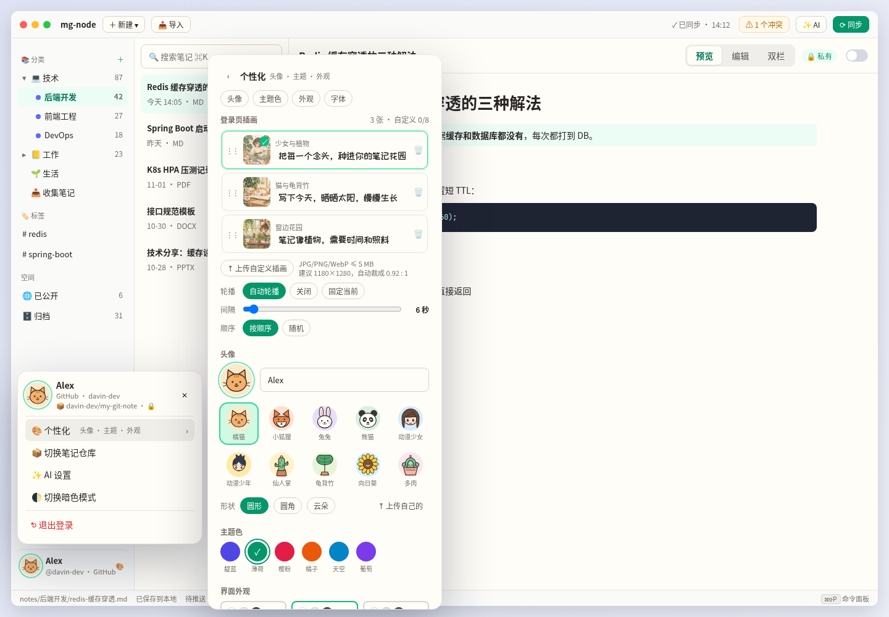


> 本章同步自 Davin 的 `CustomizePanel.tsx`、`settings.tsx` 和 `Avatar.tsx`。

- **入口**：
  1. 登录页右上角「🎨 个性化」，面板包含插画选项；
  2. 主界面侧栏左下角的个人卡片：头像、昵称和「@账号 · GitHub」，右侧有 🎨 图标。这是主界面**唯一的账号入口**；
  3. 命令面板（⌘⇧P）里的「个性化」。
- **⚠ 变更：去掉右上角头像**。原来右上角的头像和账号菜单已经删除，功能全部并入左下角个人卡片的弹层。弹层**向上展开**，最大高度不超出窗口。
- **一级菜单**（宽 300px，从上到下）：
  1. 头部：头像、昵称、「GitHub · 账号」，下面一行是当前仓库「📦 davin-dev/my-git-note 🔒」，右侧 ✕；
  2. 🎨 个性化（头像 · 主题 · 外观）›
  3. 📦 切换笔记仓库
  4. ✨ AI 设置
  5. 🌓 切换暗色模式
  6. ⎋ 退出登录
- **二级菜单（个性化浮层）**：鼠标悬停或点击「个性化 ›」，在一级菜单**右侧**弹出浮层（宽 320–380px，顶部和「个性化」行对齐，超出窗口时上移，内容多时在浮层内滚动）。
  - 顶部有「‹ 返回」，以及 4 个快捷入口：头像 / 主题色 / 外观 / 字体，点击后滚动到对应分区。
  - 内容和原来完全一样（见 6.1）：登录页插画、头像预览与昵称、10 个头像、形状、上传自己的、主题色、界面外观、手写风字体。
  - 悬停到一级菜单的其他项时，浮层自动关闭。
- **键盘**：↑/↓ 在一级菜单中移动，Enter 执行，→ 在「个性化」上打开浮层，← 或 Esc 关闭浮层并回到一级菜单，再按一次 Esc 关闭整个弹层。


- **顶栏**：只保留「✓ 已同步 · 时间」「⚠ 冲突」「✨ AI」「⟳ 同步」，按钮间距统一为 8px，右边距和左侧红绿灯对齐。
- **即时生效**：所有选项点击后立刻应用，不需要保存按钮。主题通过 CSS 变量注入：主题色写入 `--accent-50…900`，外观写入中性色，头像形状写入 `--av-radius`。

### 6.1 设置项（与他的 `Settings` 类型一一对应）
| 设置 | key | 可选值 | 默认值 | 作用 |
|---|---|---|---|---|
| 登录页插画 | `loginArt` 等 | 3 张预设 + 最多 8 张自定义（见 6.3） | anime | 登录页左栏的插画和标语；只在登录页的面板里显示（`showArt`） |
| 头像 | `avatar` | cat 橘猫、fox 小狐狸、bunny 兔兔、panda 熊猫、girl 动漫少女、boy 动漫少年、cactus 仙人掌、monstera 龟背竹、sunflower 向日葵、succulent 多肉（共 10 个手绘 SVG，每个有自己的底色） | cat | 所有头像位置 |
| 头像形状 | `avatarShape` | 圆形 `50%` / 圆角 `28%` / 云朵 `58% 42% 55% 45% / 48% 58% 42% 52%` | circle | 头像的圆角；外圈有 2px 白边加 2px `accent-300` 描边 |
| 昵称 | `nickname` | 文本，最多 12 个字 | Alex | 登录问候、侧栏个人卡片 |
| 主题色 | `accent` | indigo 靛蓝 / emerald 薄荷 / rose 樱粉 / orange 橘子 / sky 天空 / violet 葡萄（各 10 阶，等同 Tailwind 色板） | emerald | 主按钮、选中态、徽章、链接 |
| 界面外观 | `appearance` | classic 经典（冷灰白） / paper 暖纸（手账纸张，白色区域变成 `#fffdf7`） / mist 薄雾（青灰清新，`#fbfefd`） | paper | 中性色板（slate 10 阶） |
| 手写风字体 | `handFont` | 开 / 关 | 关 | 全局字体改为 `ZCOOL KuaiLe, Caveat, cursive`；标语和问候始终使用手写字体 |
| 上传自己的头像 | （按钮） | PNG/JPG/WebP，不超过 5 MB | — | 裁剪成 512×512 WebP 并去除 EXIF；保存后 `avatar` 变成 `custom` |

- ⚠ **变更**：
  - 默认主题色从靛紫 `#5b6cff` 改为他设计里的**薄荷绿**，默认外观改为**暖纸**。
  - 预设头像从 12 张位图改为他的 **10 个内联 SVG 手绘头像**（墨线 `#3b342c`，带腮红）。之前的 12 张 PNG 不再使用，素材保留在 `assets/avatars/`。
  - 头像形状从「圆形 / 圆角方形」两种增加为三种。
  - 暗色模式：他的设计里没有，我们保留为额外开关，放在左下角个人卡片弹层和命令面板里。

### 6.2 存储位置
| 数据 | 位置 | 说明 |
|---|---|---|
| 全部个性化设置（上表的 7 个 key） | 原型和他的项目：`localStorage['mg-note-settings']`（JSON）。Mac 应用：`~/Library/Application Support/mg-node/settings.json` | 本机，登录前就能读取（登录页需要用到） |
| 跟随账号同步（可选，默认开启） | 仓库 `.mgnote/profile/settings.json`（同样的 7 个 key 加 `updated`） | 换一台 Mac 登录后恢复；如果本机和仓库的值冲突，以 `updated` 较新的为准 |
| 自定义头像图片 | 本机 `…/mg-node/avatar.webp`；同步时放到 `.mgnote/profile/avatar.webp` | 回退顺序：自定义 → 预设 SVG → 平台头像（缓存 24 小时）→ 首字母 |
| 内置头像和插画 | 应用包 `app/assets/avatars/*.svg`、`app/assets/login/*.jpg`（发布时转成 WebP，每张不超过 400 KB） | 不写进仓库 |
| 手写字体 | 应用包 `app/assets/fonts/ZCOOLKuaiLe-Regular.ttf`、`Caveat.ttf`（都是 OFL 许可） | 离线可用；他的项目从 Google Fonts 在线加载 |
| Token | macOS Keychain（第 5.3 节） | **不属于**个性化设置，不会写进上面任何一个文件 |

```json
{ "accent": "emerald", "appearance": "paper", "handFont": false,
  "avatar": "cat", "avatarShape": "circle", "nickname": "Alex",
  "loginArt": "anime", "updated": "2026-11-03T15:30:00+08:00" }
```

### 6.3 登录页插画自定义


- **入口**：
  - 登录页右上角「个性化」面板；
  - 左下角个人菜单 › 个性化浮层。
  - 两处都在「登录页插画」分区，内容相同。
- **插画列表**：3 张预设和用户上传的图放在同一个列表里。每一行依次是：
  - ⋮⋮ 拖动排序（HTML5 拖放；Mac 应用里也可以用 ⌥↑/⌥↓ 移动）；
  - 缩略图，点击设为当前，带 ✓；
  - 名称，自定义图带「自定义」标记；
  - **手写标语**：直接在行内编辑，最多 24 字，用手写字体显示，留空就不显示标语；
  - 🗑 删除：预设图也可以删，删除后出现「↺ 恢复预设」；至少要保留 1 张。
- **上传自定义插画**：
  - 支持 JPG / PNG / WebP，单张不超过 **5 MB**，自定义图最多 **8 张**。
  - 建议尺寸 1180×1280。上传后按插画区比例 **0.92 : 1** 居中裁剪（Mac 应用里提供可拖动的裁剪框），导出为 920×1000 的图片。
  - 超出大小、格式不对、数量已满或本地空间不足时，都会给出提示。
- **轮播设置**：
  - 「自动轮播 / 关闭 / 固定当前」三选一。
  - 自动轮播时可以设置**间隔 5–30 秒**（默认 6 秒）和「按顺序 / 随机」。随机模式不会连续两次出现同一张。
  - 「关闭」时只能手动切换（‹ › 和圆点）。
  - 「固定当前」时隐藏导航，插画名旁边显示「📌 固定」。
  - 个性化面板打开时暂停轮播。
- **新增设置 key**（都在 `mg-note-settings` 里）：

| key | 类型 | 默认值 | 说明 |
|---|---|---|---|
| `loginArt` | string | `anime` | 当前插画 id；固定模式下就是被固定的那张 |
| `loginArts` | `{id,name?,slogan}[]` \| null | null（等于 3 张预设，顺序为 anime/cat/plants） | 插画列表的顺序、标语和自定义名称；不在列表里的预设表示已删除 |
| `carousel` | `auto` \| `off` \| `pin` | `auto` | 轮播模式 |
| `interval` | number 5–30 | 6 | 轮播间隔（秒） |
| `artOrder` | `seq` \| `random` | `seq` | 播放顺序 |

- **图片存储**：
  - 原型：每张图单独存一个 localStorage key，`mg-note-login-art:<id>`（JPEG dataURL，约 100–200 KB），不放进 settings JSON。写入失败时提示「本地存储空间不足」。
  - Mac 应用：`~/Library/Application Support/mg-node/login/<id>.webp`。
  - 开启「跟随账号同步」时，复制到仓库 `.mgnote/profile/login/<id>.webp`，`settings.json` 里只保存 id 和标语。
  - 删除插画时同时删除对应的文件。
  - 预设图随应用打包，不写进仓库。


## 7. 仓库结构约定

```text
my-git-note/                    # 私有仓库
├─ notebooks/
│  ├─ 后端开发/
│  │  ├─ redis-缓存穿透.md
│  │  └─ k8s-hpa-压测报告.pdf
│  │     └─ （批注）k8s-hpa-压测报告.pdf.mgnote.json
│  ├─ 前端工程/
│  └─ 收集笔记/                 # 插件默认写入
├─ assets/2026/11/<hash>.png    # 图片附件（按内容 hash 去重）
├─ public/                      # 已公开笔记的发布清单（不是站点本身）
│  └─ manifest.json
├─ archive/                     # 取消公开或手动归档
├─ .mgnote/
│  ├─ config.json               # 仓库级配置：默认笔记本、发布目标、LFS 规则
│  └─ profile/                  # 可选：头像与资料
├─ .gitattributes               # LFS 规则
└─ .gitignore
```

Front-matter 规范（YAML）：

```yaml
---
id: 01JBX7Q8K2M3N4P5R6S7T8V9W0   # ULID，重命名和移动后不变
title: Redis 缓存穿透的三种解法
tags: [redis, 后端开发]
public: true
slug: redis-cache-penetration     # 公开 URL 用，可选
created: 2026-11-01T10:20:00+08:00
updated: 2026-11-03T14:05:00+08:00
view_mode: split                  # 可选：preview | edit | split
---
```

DOCX、PPTX、PDF 等非 MD 文件的元数据放在同名的 `<file>.mgnote.json` 里（字段同上，另加 `annotations`）。

## 8. 主界面与 Markdown 三种模式

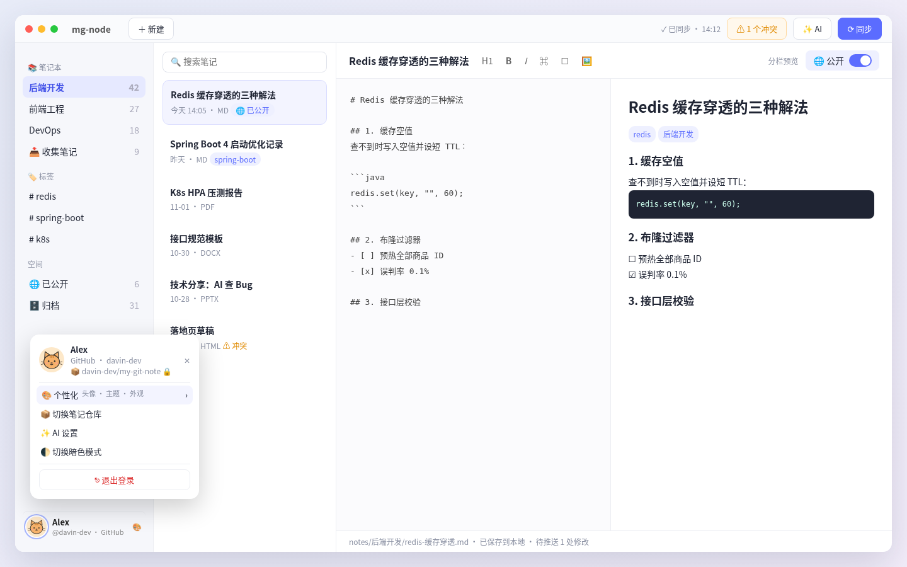

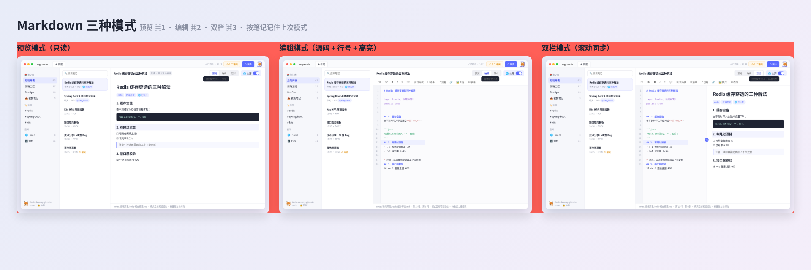

| 模式 | 快捷键 | 说明 |
|---|---|---|
| 预览 | ⌘1 | 只渲染、只读；双击某段跳到编辑模式的对应行 |
| 编辑 | ⌘2 | 纯源码：CodeMirror，带行号、语法高亮和格式工具栏 |
| 双栏 | ⌘3 | 左边源码、右边实时预览，两侧滚动同步 |

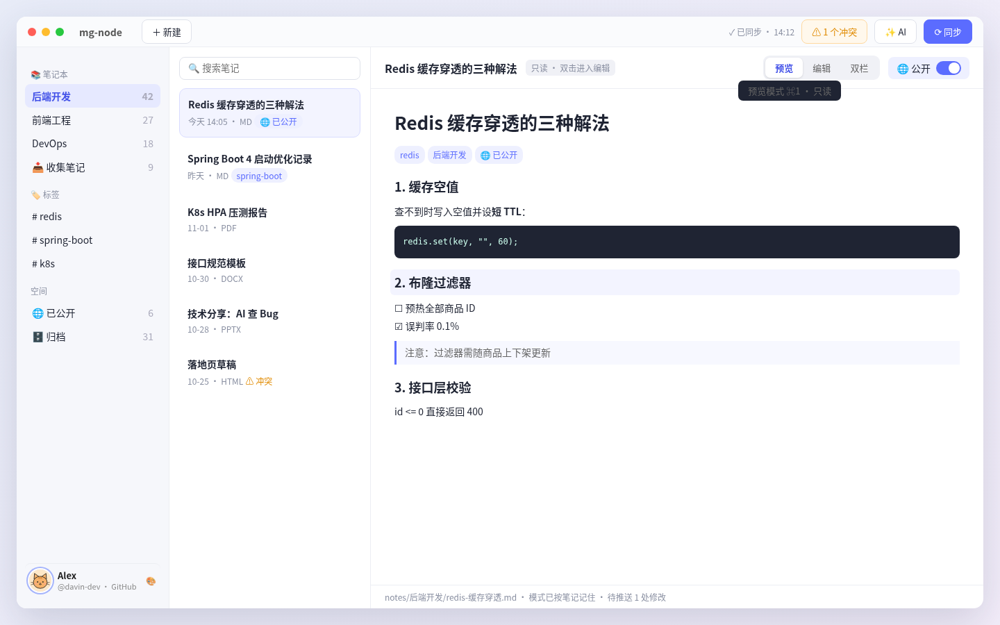
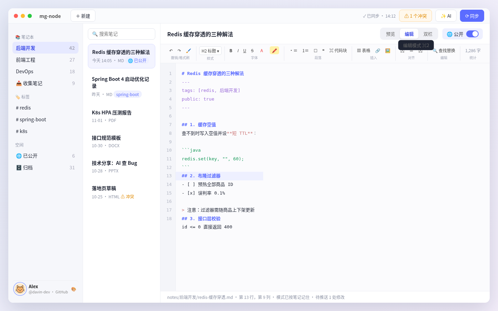
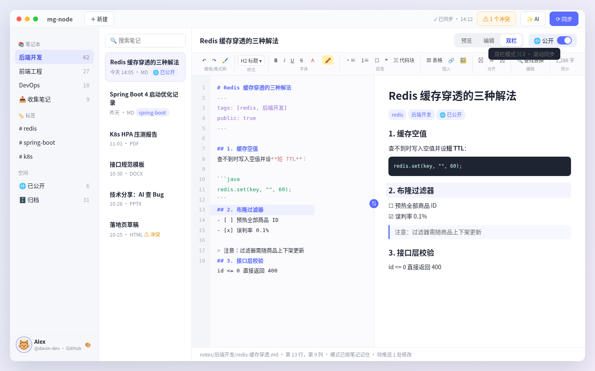

**状态机**：

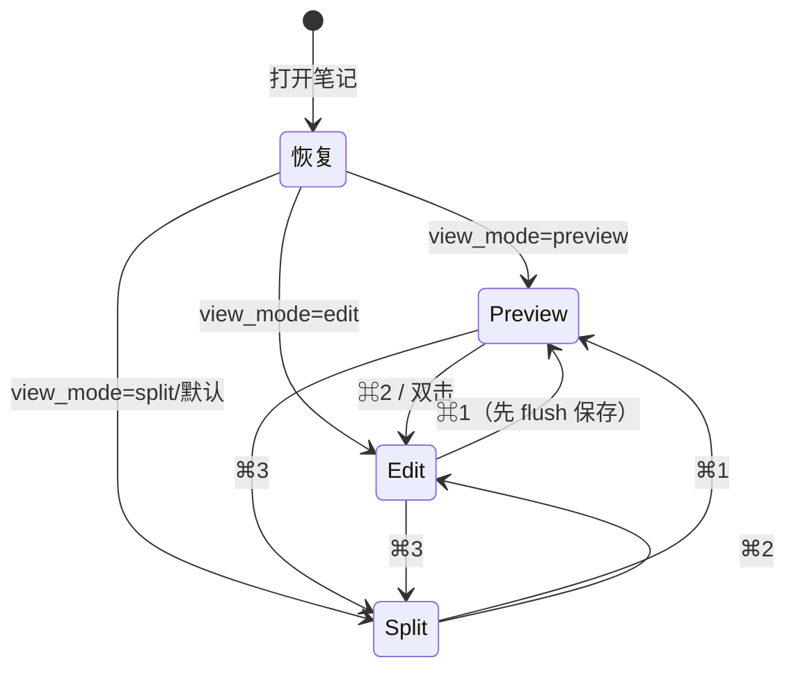

- **记住模式**：每篇笔记的模式记在本地 SQLite（`note_state.view_mode`），不写进 front-matter，避免产生无意义的提交；front-matter 里的 `view_mode` 只作为作者设定的默认值。新笔记默认双栏。
- **滚动同步**：markdown-it 渲染时给块级 token 加 `data-line`；编辑器滚动时取视口顶部行号，二分查找对应的预览元素并插值滚动；反向同理。用一个 `syncing` 标志加 `requestAnimationFrame` 防止两边互相触发。
- **性能**：预览渲染做 150ms 防抖，放在 Web Worker 里；超过 1 MB 的笔记默认进入编辑模式，并提示「预览已暂停」；图片懒加载；CodeMirror 自带视口渲染。
- **保存**：输入停止 800ms 后自动保存到工作区（不提交）；提交由同步流程完成。

## 9. 仿 WPS 的分组工具栏

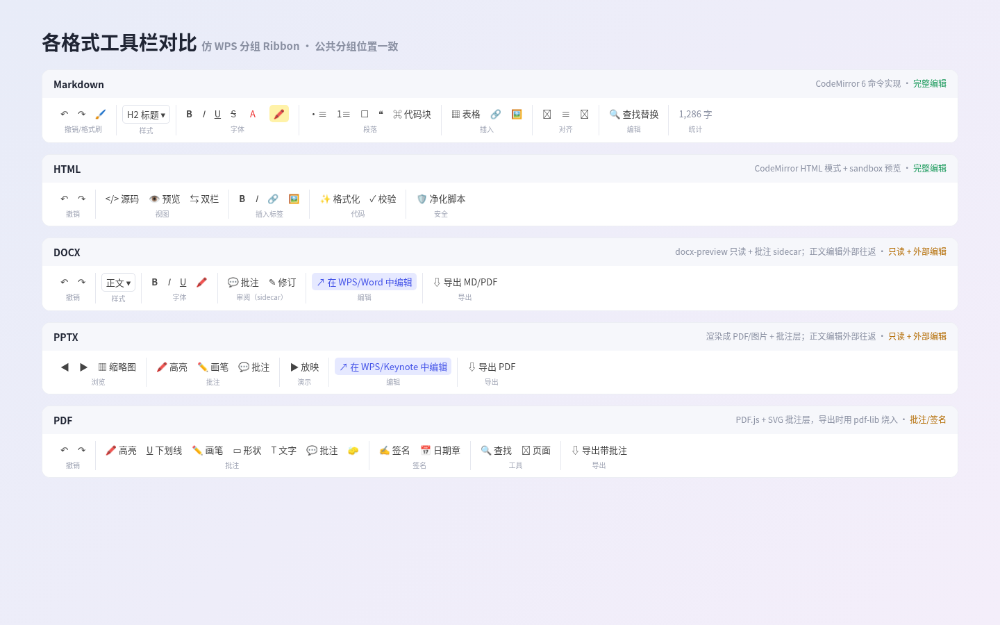

所有格式共用同一套**分组 Ribbon**：撤销 / 样式 / 字体 / 段落 / 插入 / 对齐 / 编辑 / 统计。公共分组位置固定，不同格式只增减组，用户切换格式时不需要重新找按钮。工具栏宽度不够时，右侧的组自动折叠进「⋯」菜单。

| 格式 | 工具栏 | 实现与可行性 |
|---|---|---|
| Markdown | 撤销/重做、格式刷、标题级别下拉、B/I/U/S、文字颜色/高亮、无序/有序列表、☐ 清单、引用、代码块、表格插入与编辑、链接、图片、对齐、查找替换、字数统计 | **完整可行**。全部是 CodeMirror 6 的 command，用来改写源码。MD 没有下划线、颜色和对齐语法，分别写成 `<u>`、`<mark style>` 和 `<p align>` 这类内联 HTML（受 DOMPurify 白名单约束），并在设置里提示「会降低可移植性」。格式刷会复制选区外层的标记（`**`、`~~`、`<mark>`）。表格编辑在光标进入表格时显示浮动条（增删行列、对齐），并自动对齐 `|` 列宽 |
| HTML | 撤销、源码/预览/双栏、常用标签插入、格式化（prettier/standalone）、校验、脚本净化 | **完整可行**。预览放在 sandbox iframe 里 |
| DOCX | 样式和字体（灰显，只读提示）、批注/修订、**在 WPS/Word 中编辑**、导出 | 与「技术选型」一节的决策一致：**只读渲染加批注 sidecar**。字体和段落按钮只在「外部编辑」打开后才有意义，所以在 MVP 中灰显，悬停提示「在 WPS 中编辑」。后续接入 OnlyOffice 后，这些按钮会映射到它的 API |
| PPTX | 浏览、批注、放映、**在 WPS/Keynote 中编辑**、导出 PDF | 同上；放映是全屏逐页显示渲染出的页面 |
| PDF | 高亮、下划线、画笔、形状、文字、批注、橡皮、**签名**（手写或图片签名，保存在 Keychain 关联的本地加密文件里）、日期章、导出带批注的 PDF | **可行**。用 PDF.js 显示加 SVG 批注层，导出时用 pdf-lib 把批注烧入新文件，原文件不改 |


## 10. 类 IDEA 的智能提示

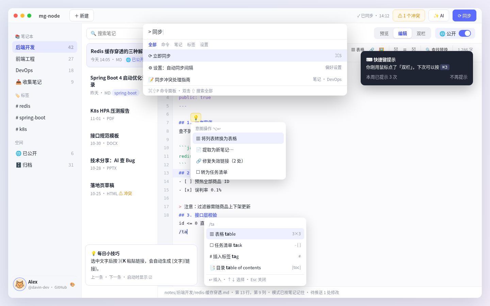

- **斜杠命令与补全**：在行首或空格后输入 `/` 时弹出补全菜单（CodeMirror `@codemirror/autocomplete`），支持模糊匹配，例如 `/ta` 匹配表格、任务清单、标签和目录。Markdown 触发符也会补全：`[[` 补全笔记标题（双链）、`#` 补全已有标签、`` ``` `` 补全语言名、`:` 补全 emoji、`](` 补全仓库内路径。
- **意图操作 ⌥↩**：光标所在的语法节点（基于 Lezer 语法树）满足条件时，行首显示 💡；按 ⌥↩ 列出可执行操作：
  - 列表 ↔ 表格、CSV 粘贴 → 表格
  - 修复失效链接（在索引里查重命名记录）
  - 提取选区或当前标题为新笔记（原处替换成 `[[链接]]`）
  - 转为任务清单、为代码块补语言、图片转为本地 assets
  - 每个意图是一个 `Intention { id, title, isAvailable(ctx), apply(ctx) }`，可以注册扩展。
- **命令面板 ⌘⇧P / 双击 ⇧ 搜索全部**：统一的搜索入口，结果分为命令、笔记（FTS5）、标签和设置几类；命令旁边显示快捷键；最近使用的排在前面。
- **快捷键提示**：所有按钮的 tooltip 都写成「名称 + 快捷键」。**Key Promoter**：用户用鼠标执行一个有快捷键的操作，同一操作累计 3 次后，右上角弹出一次提示「下次可以按 ⌘3」，每个操作最多提示 3 次，可以永久关闭。
- **每日小技巧**：启动时（可关闭）展示一条，内容来自内置的 `tips.json`，按用户还没用过的功能优先排序。

## 11. 同步设计

1. **pull**：`fetch` 后，如果本地有未提交修改，先 `commit`（消息为 `mg-node: auto save <时间>`），再 `merge`（不用 rebase，便于回溯）。
2. **冲突检测**：`git2::Index::has_conflicts()`。MD 文件做三方合并；无法自动合并时生成冲突项，**不写 `<<<<<<<` 标记到文件**，而是在 UI 里用三栏「我的 / 远端 / 合并结果」解决；二进制文件让用户「保留两者」（另存为 `name (冲突 时间).ext`）。
3. **push**：失败时（non-fast-forward）自动重试一次 pull 加 merge。
4. **触发方式**：手动点「同步」；自动同步默认每 5 分钟一次，另外在窗口失焦和退出前各同步一次，可以关闭。
5. **离线队列**：离线时只做本地提交，记录 `pending_push` 计数，状态栏显示「待推送 N」，联网后自动推送。
6. **大文件**：超过 20 MB 的文件建议走 LFS（`.gitattributes` 规则）。Gitee 对 LFS 有容量限制，免费版不一定可用，开发前需要核实当前额度；超出限制时提示用户「只存本地，不上传」。GitHub 单文件硬上限 100 MB，LFS 免费额度也有限。
7. **状态展示**：「✓ 已同步 · 14:12」「⟳ 同步中」「⚠ 1 个冲突」「⏸ 离线 · 待推送 3」。

## 12. 退出时自动同步

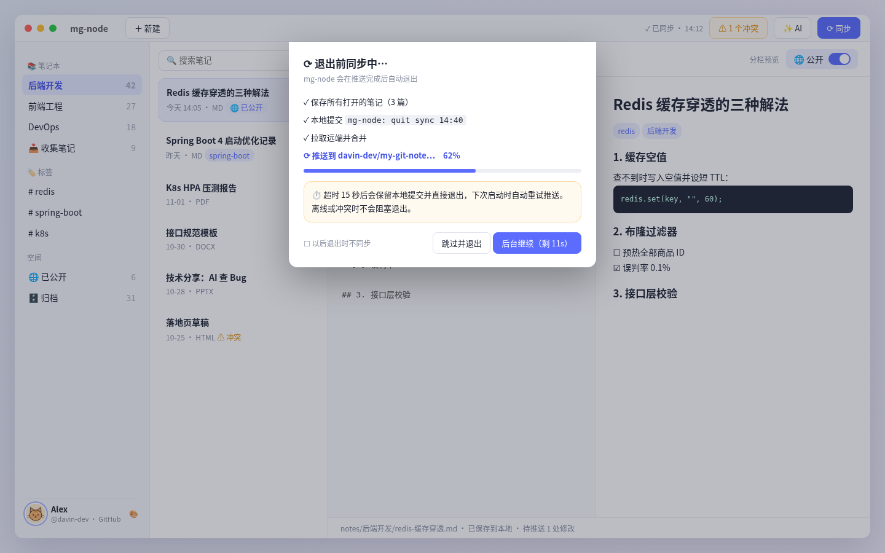

**流程**：⌘Q、关闭最后一个窗口或系统关机时，依次执行：flush 编辑器缓冲 → 保存 → 本地 commit → pull 并 merge → push。顶部弹出进度 sheet，逐步打勾显示进度。

- **macOS 实现**：Tauri 2 的 `RunEvent::ExitRequested` 调用 `api.prevent_exit()`，相当于 AppKit `applicationShouldTerminate` 返回 `.terminateLater`；完成后调用 `app.exit(0)`，对应 `replyToApplicationShouldTerminate(true)`。
- **超时**：默认 15 秒（可设 5–60 秒）。超时、离线或遇到冲突时，**保留本地提交并直接退出**，写入 `sync_queue`，下次启动后第一件事就是重试推送，并通知「上次退出时有 N 个提交未推送」。冲突不在退出时处理，留到下次启动弹出冲突界面。
- **不会无限阻塞**：sheet 上始终有「跳过并退出」按钮；「后台继续」会隐藏窗口，在 Dock 显示进度，倒计时结束后强制退出。
- **关机/注销**：系统发出 `NSWorkspaceWillPowerOffNotification` 时时间更紧，只做 flush、保存和本地 commit（通常不超过 1 秒），**跳过网络操作**，交给下次启动。
- **崩溃保护**：编辑器每 800ms 自动保存到工作区，所以即使被强制结束，最多丢失不到 1 秒的输入；未提交的改动在下次启动时自动提交。
- 设置项：「退出时同步」（默认开）、超时时长、「以后退出时不同步」。

## 13. 文档查看/编辑与批注

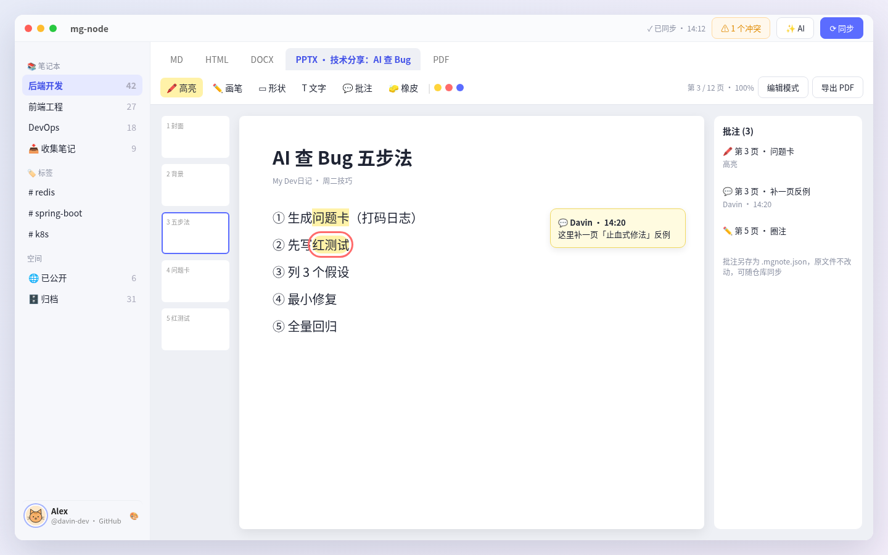

- 顶部的标签栏按文件类型切换（MD / HTML / DOCX / PPTX / PDF）。
- **PDF**：PDF.js 渲染，顶层 SVG 覆盖层支持高亮、画笔、形状、文字、评论和橡皮。
- **PPTX/DOCX**：默认只读渲染。「编辑模式」用系统默认应用打开，保存后通过 FSEvents 监听文件变化，再重新渲染和索引。
- **批注存储**：原文件**不修改**，批注写进 `<file>.mgnote.json`：

```json
{ "version": 1, "file": "k8s-hpa-压测报告.pdf", "sha256": "…",
  "annotations": [
    { "id": "a1", "type": "highlight", "page": 3,
      "rects": [[0.12,0.30,0.45,0.33]], "color": "#ffd43b",
      "author": "davin-dev", "created": "2026-11-03T14:20:00+08:00" },
    { "id": "a2", "type": "comment", "page": 3, "anchor": [0.6,0.4],
      "text": "补一页「止血式修法」反例" } ] }
```

坐标使用页面相对比例（0–1），缩放后不会错位；原文件 sha256 变化时提示「批注可能错位」。

## 14. 公开发布

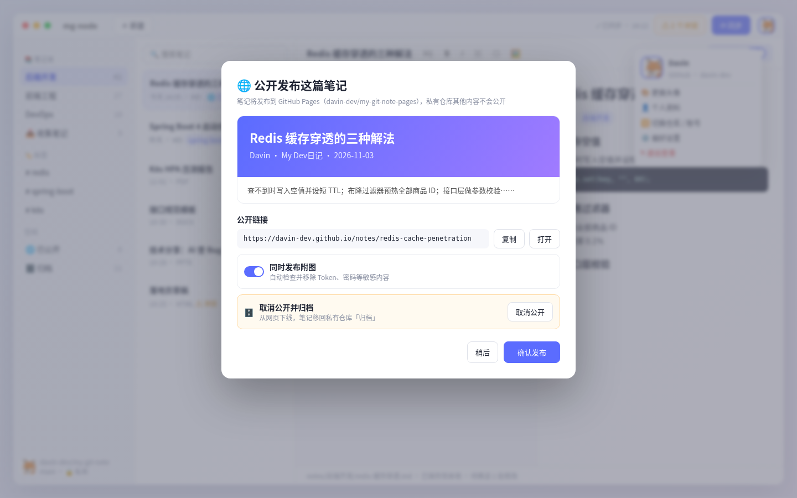

**流程**：打开公开开关 → 敏感信息扫描 → 确认窗（预览卡片和链接）→ front-matter 写 `public: true` → 渲染成静态 HTML → 推送到公开站点仓库 `<user>.github.io` 或 `my-git-note-pages`（gh-pages 分支）→ 更新 `public/manifest.json` → 返回 URL。

- **静态站构建**：在 Rust 侧调用内置模板（remark 产出 HTML 后套模板，模板是打包进应用的 JS）；只复制被引用的 assets；图片路径改成相对路径。
- **敏感信息扫描**：正则匹配 + 熵值检测（参考 gitleaks 规则）：AWS/GitHub/OpenAI 风格的 key、`password=`、私钥头、手机号、内网 IP；命中后列出位置，要求用户逐条确认或自动打码，否则不允许发布。
- **取消公开 / 归档**：从站点仓库删除对应页面并推送，front-matter 改为 `public: false`，笔记移到 `archive/`（可选，保留 id，链接失效）。
- **Gitee Pages 现状**：经检索，Gitee Pages 已经**下线**，Gitee 官方更新日志写着「Gitee Pages 服务已下线，恢复时间暂无计划」（2024 年起陆续停服）。因此 **MVP 只支持 GitHub Pages**；Gitee 用户可以选择把公开站点发布到 GitHub，或后续接入 Cloudflare Pages、腾讯云 EdgeOne Pages（国内加速需要 ICP 备案）。另外，GitHub Pages 在国内访问可能不稳定，需要提示用户。

## 15. 浏览器插件

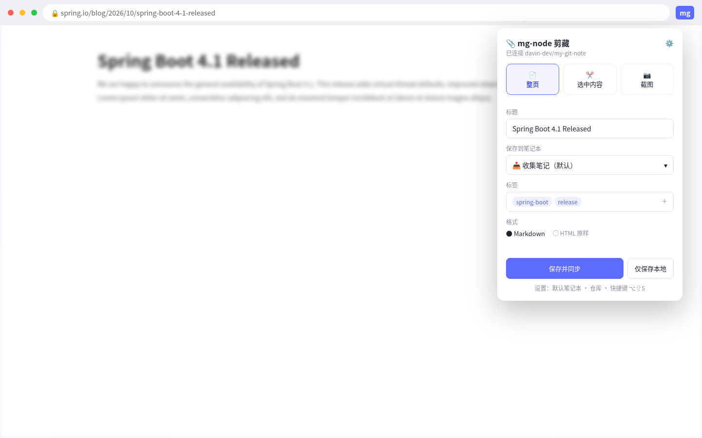

- **Manifest V3**：`action` 弹窗加 `service_worker`，权限为 `activeTab`、`scripting`、`storage`、`contextMenus`；`host_permissions` 只写 `http://127.0.0.1:47321/*` 和 API 域名。
- **剪藏模式**：
  - 整页：注入 Readability 提取正文，再用 Turndown 转成 MD。
  - 选中内容：`window.getSelection()` 取 HTML，再转成 MD。
  - 截图：`chrome.tabs.captureVisibleTab`，支持区域选择。
  - 输出格式可选 Markdown 或 HTML 原样；front-matter 自动加 `source_url`。
- **推送通道**：
  1. **优先通过本地桥接**：Mac 应用在 127.0.0.1 上监听，插件首次配对时显示 6 位配对码，换取 token 后存进 `chrome.storage.local`；由 Mac 应用写文件、提交并按同步策略推送。好处是插件里不保存 Git token。
  2. **备用通过 API 直推**：Mac 应用没有运行时，插件用 GitHub Device Flow 单独授权，调用 `PUT /repos/{owner}/{repo}/contents/{path}` 写入 `notebooks/收集笔记/`；Gitee 同理使用 v5 Contents API。
- **设置**：默认笔记本（默认「收集笔记」）、仓库、默认标签、快捷键 ⌥⇧S、通道优先级。

## 16. AI 知识库助手

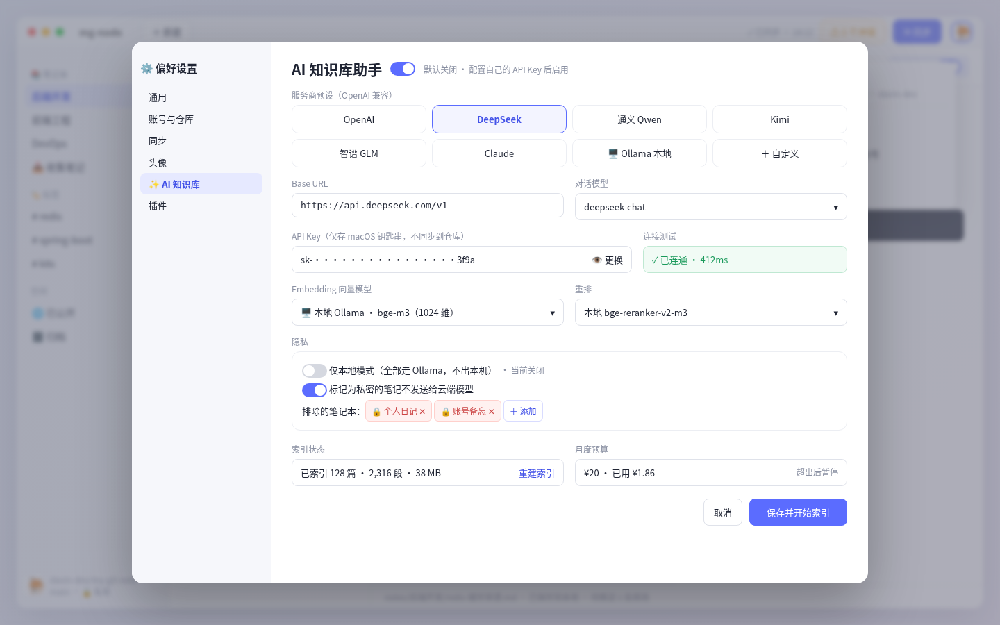

**默认关闭**。用户配置了自己的 API Key（或本地 Ollama）后才启用。启用后提供：带引用的知识库问答、总结（单篇 / 笔记本 / 标签）、日报和周报。

### 服务商配置
- 统一使用 **OpenAI 兼容协议**（`/chat/completions`、`/embeddings`），字段为 Base URL、对话模型、向量模型和 API Key。
- 预设（每个预设只填 Base URL 和推荐模型，**开发前要按各家最新文档核对一遍**）：

| 预设 | Base URL（示例） | 说明 |
|---|---|---|
| OpenAI | `https://api.openai.com/v1` | |
| DeepSeek | `https://api.deepseek.com/v1` | |
| 通义 Qwen | `https://dashscope.aliyuncs.com/compatible-mode/v1` | DashScope 兼容模式 |
| Kimi | `https://api.moonshot.cn/v1` | |
| 智谱 GLM | `https://open.bigmodel.cn/api/paas/v4` | |
| Claude | `https://api.anthropic.com/v1` | 有 OpenAI 兼容层；或通过适配器走原生 Messages API |
| Ollama 本地 | `http://127.0.0.1:11434/v1` | 不需要 Key，完全本地 |
| 自定义 | 用户填写 | 例如公司网关、AMD 等兼容端点 |

- **Key 只存 Keychain**（`com.mgnode.ai/<provider>`），**永远不写进仓库、`.mgnote/`、日志或崩溃报告**；导出设置时也会剔除。
- **连接测试**：发送 `GET /models` 和一次 1 token 的 chat 请求，显示耗时和错误码（401 Key 错误 / 404 模型不存在 / 429 限流）。

### 向量化与切块
- 向量模型可选：云端（例如 `text-embedding-3-small`、通义 `text-embedding-v3`）或**本地 Ollama `bge-m3`**（1024 维，中英文都好，推荐默认）。更换向量模型后必须全量重建索引（表里记录 `embed_model`）。
- **切块**：MD 按标题层级切分（以 H2/H3 为边界），每块约 300–800 token，相邻块重叠 50 token；每块带上「笔记标题 › 标题路径」前缀，以及 `note_id`、`heading`、`line_start/end`。代码块尽量不拆开。
- **非 MD 文本提取**：PDF 用 pdf.js 的 `getTextContent`，按页切块，记录页码；DOCX 用 mammoth 提取文本，按标题样式切块；PPTX 解析 `ppt/slides/*.xml` 里的文本和备注，按页切块；扫描件 PDF 可选本地 OCR（后续）。

### 检索：混合检索加重排
1. 向量召回：本地 **SQLite + sqlite-vec**（`vec0` 虚拟表），取 top 20。
2. 关键词召回：**FTS5 BM25**，取 top 20，对代码标识符和专有名词效果好。
3. 用 RRF（Reciprocal Rank Fusion）融合结果，再按**范围过滤**（全部 / 笔记本 / 标签 / 当前笔记）。
4. **重排**：本地 `bge-reranker-v2-m3`（通过 Ollama 或 onnxruntime）或云端 rerank API，取 top 5–8 段放进上下文；不开重排时直接用 RRF 的结果。

### 增量索引
同步完成后，执行 `git diff --name-status <old_head> <new_head>` 得到 A/M/D/R 列表，只对变化的文件重新切块和向量化；按块内容的 hash 去重，块没变就不重新向量化；重命名只更新 path。索引在后台队列里运行，可以暂停，状态栏显示「索引中 12/40」。

### 问答、总结与引用

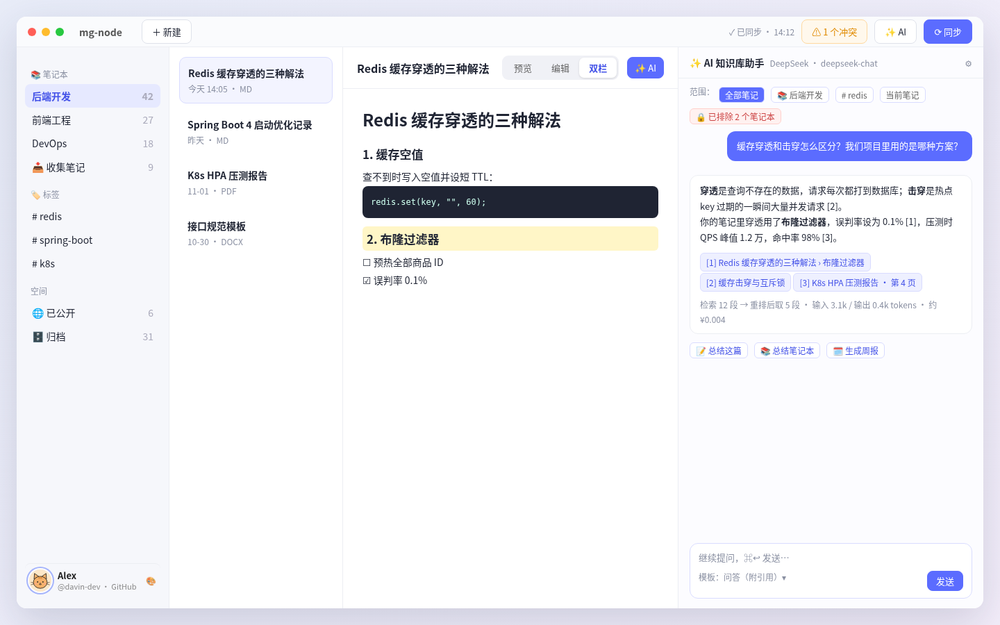

- 编辑器右侧 ✨ AI 侧栏（⌘J），顶部是范围选择 chip，显示已排除的笔记本。
- **提示词模板**（可在设置里编辑，存放在 `.mgnote/ai/prompts/*.md`，模板本身可以同步）：问答（必须引用）、总结、日报/周报、提取待办、解释代码。
- 问答系统提示要求：只根据提供的片段回答；每句结论后标 `[n]`；找不到就说「笔记中没有相关内容」，不要编造。
- **引用 chip**：`[1] 笔记标题 › 小标题` 或 `· 第 4 页`。点击后打开笔记，滚动到 `line_start` 并高亮约 2 秒；PDF 跳到对应页。引用的 `note_id` 与回答一起保存，即使笔记改名，引用依然有效。
- 回答下方显示「检索 12 段 → 重排 5 段 · 输入/输出 tokens · 估算费用」。

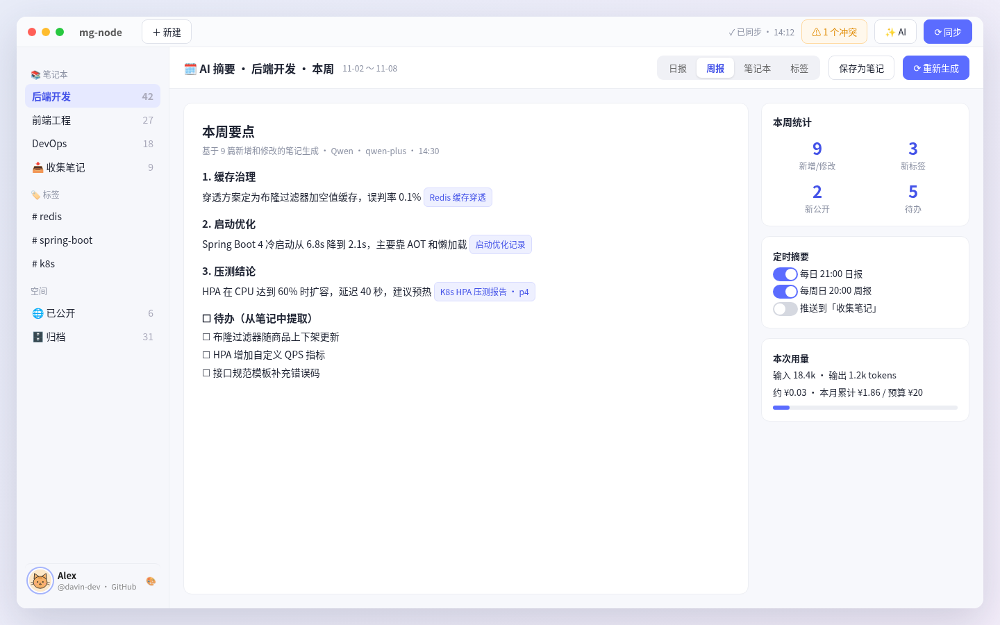

- **总结**：单篇用 map 加 reduce；笔记本或标签先逐篇摘要再汇总，并缓存每篇的摘要（按内容 hash）。
- **日报/周报**：基于 `git log --since` 找到新增和修改的笔记，生成要点、统计和待办。可以按时间自动生成（默认关闭），结果可以「保存为笔记」，写进 `notebooks/AI 摘要/2026-W45.md`。

### 隐私
- **按笔记本排除**，也可以在 front-matter 里写 `ai: false` 单篇排除。被排除的内容**不会建索引，也不会发给模型**。
- 笔记标记为 `private: true` 时，默认不发给云端模型，除非用户在设置里明确允许。
- **仅本地模式**：对话、向量化和重排全部走 Ollama，不访问外网；开启后界面显示「🖥 本地」标识。
- 发送前统一经过「公开发布」一节的**敏感信息扫描**，命中的内容打码后再发送。
- **用量与费用**：每次调用都记入 `ai_usage` 表；按预设单价表（用户可改）估算费用；可以设月度预算，超出后暂停并提示；发送前先用 tokenizer 估算 token 数，超过上下文限制时自动裁剪。

### 数据表

```sql
CREATE TABLE ai_chunk (id INTEGER PRIMARY KEY, note_id TEXT, path TEXT, heading TEXT,
  line_start INT, line_end INT, page INT, text TEXT, hash TEXT, embed_model TEXT, updated TEXT);
CREATE VIRTUAL TABLE ai_vec USING vec0(chunk_id INTEGER PRIMARY KEY, embedding float[1024]);
CREATE VIRTUAL TABLE ai_fts USING fts5(text, heading, content='ai_chunk', content_rowid='id');
CREATE TABLE ai_index_state (repo_id INT PRIMARY KEY, indexed_head TEXT, embed_model TEXT, status TEXT);
CREATE TABLE ai_conversation (id TEXT PRIMARY KEY, scope TEXT, title TEXT, created TEXT);
CREATE TABLE ai_message (id TEXT PRIMARY KEY, conv_id TEXT, role TEXT, content TEXT,
  citations TEXT /* JSON: [{n,note_id,heading,line_start,page}] */, created TEXT);
CREATE TABLE ai_usage (id INTEGER PRIMARY KEY, provider TEXT, model TEXT, kind TEXT,
  tokens_in INT, tokens_out INT, cost_cny REAL, created TEXT);
CREATE TABLE ai_summary_cache (key TEXT PRIMARY KEY, hash TEXT, summary TEXT, created TEXT);
```

### 模块
- `src-tauri/ai/`：`provider/`（openai_compat、anthropic 适配、ollama）、`chunker/`、`extract/`（pdf/docx/pptx）、`embed/`、`retrieve/`（vec、fts、rrf、rerank）、`indexer/`（git diff 增量）、`usage/`。
- `src/ai/`：`AiPanel`、`ScopePicker`、`CitationChip`、`DigestView`、`AiSettings`。
- `packages/prompts/`：默认提示词模板。

### 排期与风险
- 放在 **M5（第 13–15 周）**：M5a 配置、索引和问答；M5b 总结、日报周报和用量统计。
- 风险：
  - 各家兼容接口的细节不同（流式格式、embeddings 维度、Claude 兼容层的限制）。
  - sqlite-vec 仍在快速迭代，需要锁定版本。
  - 本地 bge-m3 加重排模型需要约 3 GB 内存和磁盘，在低配 Mac 上会比较慢。
  - 模型可能编造或引用错误，用「必须引用」加「找不到就说没有」来缓解，但无法根除。
  - 云端模型存在数据合规问题（默认排除私密内容并提示用户）。

## 17. 新建：文件夹与文件

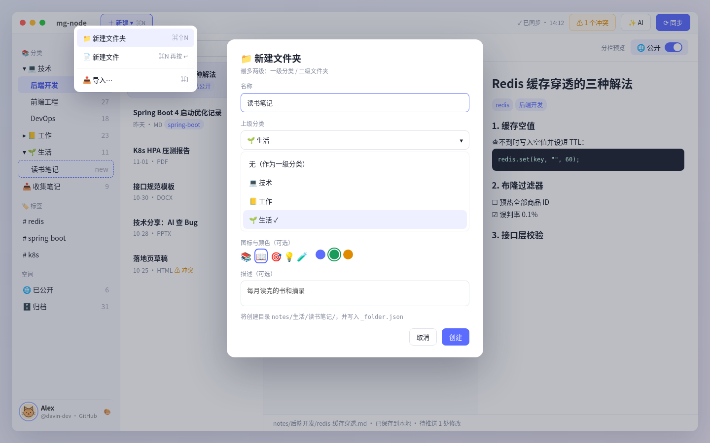

### 入口
- 标题栏的「＋ 新建 ▾」按钮，或按 **⌘N**，会展开菜单：**📁 新建文件夹（⌘⇧N）**、**📄 新建文件**、📥 导入…（⌘I）。
- 在侧栏某个分类上右键，也能新建，并自动带上「上级分类」或「存放位置」。

### 新建文件夹：最多两级
| 字段 | 说明 |
|---|---|
| 名称 | 必填，1–40 个字符，不能包含 `/ \ : * ? " < > \|`；同一级下不能重名（不区分大小写，因为 macOS 默认文件系统不区分） |
| 上级分类 | 「无」表示新建一级分类；选一个已有一级分类，就在它下面新建二级文件夹。下拉框只列一级分类，所以不可能建出第三级 |
| 图标 / 颜色 | 可选：emoji 加 6 种预设颜色 |
| 描述 | 可选，显示在侧栏的悬停提示和 AI 索引范围选择里 |

**层级规则：最多 2 级（一级分类 / 二级文件夹），笔记只放在二级文件夹或一级分类根下。**
限制层级的原因：

1. 侧栏宽度只有 200 px，三级以上缩进后名字会看不清，也很难拖放；
2. 每个笔记的路径更短、更稳定，发布地址、相对链接和 git diff 都更易读；
3. 导入、AI 索引范围、浏览器插件选择默认笔记本，都只需要一个两级的级联选择；
4. 更细的分类交给**标签**（可以多选，不受层级限制）。
导入时遇到更深的目录，三级及以下会合并为二级文件夹名，例如 `后端/redis/集群` 变成 `后端 / redis-集群`；也可以选择平铺。

**仓库目录映射**
```
notes/
  技术/                     # 一级分类 = 一级目录
    _folder.json            # {"icon":"💻","color":"#5b6cff","desc":"…","order":["后端开发","前端工程","DevOps"]}
    后端开发/               # 二级文件夹 = 二级目录
      _folder.json
      redis-缓存穿透.md
  生活/读书笔记/…
  收集笔记/                 # 浏览器插件默认的收集位置（一级）
```
- 显示顺序保存在上一级的 `_folder.json` 的 `order` 字段里，不用数字前缀，所以目录名保持干净。
- 空文件夹也会因为 `_folder.json` 存在而被 git 跟踪。

**侧栏树**：一级分类可以展开或折叠（状态存在本地），显示笔记数量。

- 拖放：同一级内拖动可以调整顺序（只改 `order` 字段）。
- 把二级文件夹拖到另一个一级分类下，就是移动（`git mv`，同时改写相对链接）。
- 把一级分类拖进另一个一级分类时，如果它下面没有子文件夹就允许，会变成二级；有子文件夹就拒绝，并提示「最多两级」。
- 重命名或移动都会生成一次提交：`mg-node: move 生活/读书笔记 -> 技术/读书笔记`。

### 新建文件：选择类型

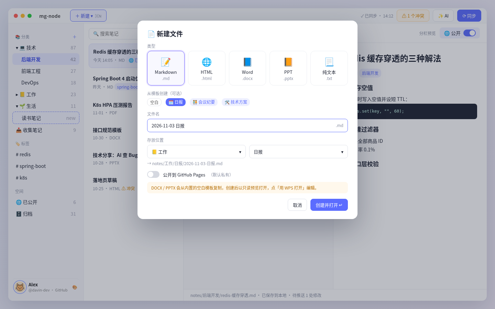

| 类型 | 扩展名 | 创建方式 | 打开方式 |
|---|---|---|---|
| Markdown | .md | 写入 front-matter 和标题 | MD 编辑器（按上次用的模式） |
| HTML | .html | 写入最小的 HTML5 骨架 | HTML 编辑器（源码加预览双栏） |
| Word | .docx | 复制内置的 `templates/blank.docx`（docx 库生成，约 6 KB） | 只读预览 + 「用 WPS 打开」（与前面 DOCX/PPTX 文档查看的决定一致） |
| PPT | .pptx | 复制内置的 `templates/blank.pptx`（16:9 一页标题页） | 只读预览 + 外部编辑 |
| 纯文本 | .txt | 空文件 | 纯文本编辑器 |

- **从模板创建**（可选）：空白、🗓 日报、🧑‍🤝‍🧑 会议纪要、🛠 技术方案。
  - 模板放在仓库的 `.mgnote/templates/` 下，可以自定义，也会同步。
  - 支持变量 `{{date}}` `{{time}}` `{{user}}` `{{folder}}`。
  - MD 和 HTML 模板直接展开；DOCX 和 PPTX 模板用 docx-templater 替换变量。
- **文件名**：默认按模板生成，例如「2026-11-03 日报」。扩展名跟随类型自动设置；保存到磁盘时，空格会替换成 `-`。
- **存放位置**：两级级联下拉框，先选一级分类，再选二级文件夹（或「一级根目录」）。默认是当前选中的文件夹，下方实时显示最终路径。
- **公开开关**：默认私有。打开后写入 `public: true`；DOCX 和 PPTX 公开时会生成 PDF 版本用于 Pages 发布。
- 按「创建并打开 ↵」：写入文件，生成一次本地提交 `mg-node: new 工作/日报/2026-11-03-日报.md`，然后按同步策略推送。

## 18. 本地导入

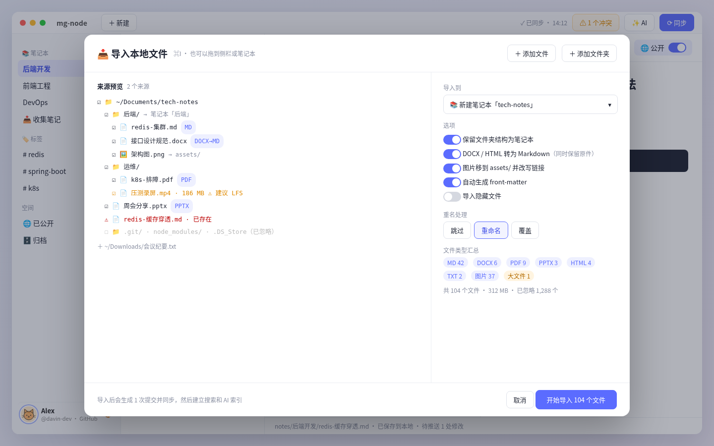

### 入口
- 菜单「文件 › 导入…」**⌘I**，以及工具栏的「📥 导入」按钮。
- **拖放**：把文件或文件夹拖到侧栏，或拖到某个笔记本上，就直接导入到那个笔记本。
- **Finder「打开方式」**：在 Tauri 的 `bundle.fileAssociations` 注册 md、html、txt、docx、pptx、pdf；双击或用「打开方式 › mg-node」时，先弹出导入对话框，并预选当前笔记本。

### 范围与结构
- 支持单个文件、多个文件、整个文件夹，也可以混合添加多个来源。
- 选择「保留文件夹结构为笔记本」时，子文件夹会映射成嵌套笔记本 `notebooks/<目标>/<子目录>/`；关闭后会把所有文件平铺到目标笔记本。
- 支持的类型：
  - `md`、`txt`：`txt` 会转成 `.md`。
  - `html`：可以转成 MD（Turndown）或保留原样。
  - `docx`：可以转成 MD（mammoth 转 HTML 再用 Turndown 转 MD），或保留原件；也可以「两者都要」，原件放在 `原名.docx`，旁边生成同名 `.md`。
  - `pptx`、`pdf`：保留原件，并提取文本供搜索和 AI 使用。
  - 图片：png、jpg、gif、webp、svg。
  - 旧版 `.doc`、`.ppt`：MVP 不支持，会提示另存为新格式。

### 资源与链接
- 解析 MD 和 HTML 中的 ``、``，把引用的图片复制到 `assets/YYYY/MM/<sha256 前 12 位>.<ext>`（相同内容自动去重），并**改写链接**为相对于新笔记位置的路径。
- 笔记之间的相对链接（`../a.md`）按新的目录映射改写；找不到目标时保留原文，并在报告里列为「失效链接」。
- **front-matter 生成**：已有 front-matter 的保留并补全缺失字段；没有的生成 `id`（ULID）、`title`（第一个 H1，或文件名）、`tags: []`、`public: false`、`created`（文件创建时间）、`updated`（文件修改时间）、`source: import:<原路径>`。

### 过滤与大文件
- 默认忽略 `.git/`、`node_modules/`、`.DS_Store`、隐藏文件，以及 `.gitignore` 里列出的规则（可选开启）；用户也可以添加自定义 glob。
- 单个文件超过 **50 MB** 时，提示加入 LFS（写入 `.gitattributes`）；超过 **100 MB** 而且没有 LFS 时，GitHub 会拒收，默认「只存本地，不上传」。Gitee 的 LFS 额度需要核实（见风险一节）。
- 导入前先汇总：每种类型的文件数、总大小、忽略数量和大文件数量。

### 重名与冲突
同一路径已经存在时，可以统一选择或逐个选择：**跳过 / 重命名（`名称 (2).md`，默认）/ 覆盖**。覆盖前，旧版本仍然保留在 git 历史里，可以回滚。

### 进度、提交与索引

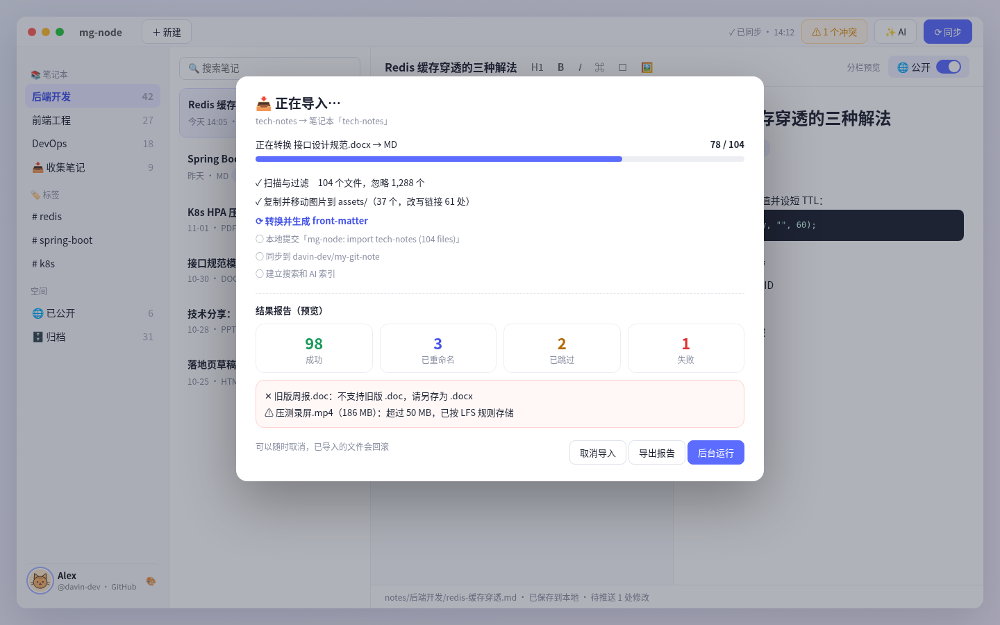

1. 在 Rust 后台任务里分阶段执行：扫描过滤 → 复制资源 → 转换并生成 front-matter → 写入工作区。用 Tauri event 回传进度。
2. **可以随时取消**：先写到临时目录 `.mgnote/tmp/import-<id>/`，完成后再原子移动；取消时删除临时目录，工作区不受影响。
3. 完成后只生成 **1 次提交**：`mg-node: import <来源名> (N files)`，然后按同步策略推送。
4. 推送后加入搜索索引（FTS5）和 AI 增量索引（如果已启用）。
5. 结果报告：成功、重命名、跳过、失败的数量，以及失败原因和失效链接；可以导出为 MD 报告。

### 后续格式（M6）
- **Obsidian** vault：`[[双链]]`、`![[嵌入]]`、`.obsidian` 忽略。
- **Typora**：本质是 MD，处理图片目录规则。
- **Notion 导出**（Markdown 加 CSV zip）：去掉文件名中的 hash 后缀，CSV 数据库转成表格。
- **印象笔记 .enex**：XML 加 ENML 转成 MD，base64 资源还原成文件，标签映射。

## 19. 数据模型（本地 SQLite）

```sql
CREATE TABLE repo   (id INTEGER PRIMARY KEY, provider TEXT, owner TEXT, name TEXT,
                     local_path TEXT, default_branch TEXT, last_sync_at TEXT, head_sha TEXT);
CREATE TABLE note   (id TEXT PRIMARY KEY, repo_id INT, path TEXT UNIQUE, title TEXT,
                     kind TEXT CHECK(kind IN('md','html','docx','pptx','pdf','other')),
                     notebook TEXT, public INT DEFAULT 0, archived INT DEFAULT 0,
                     public_url TEXT, created TEXT, updated TEXT, blob_sha TEXT);
CREATE TABLE tag    (note_id TEXT, name TEXT, PRIMARY KEY(note_id, name));
CREATE TABLE note_state (note_id TEXT PRIMARY KEY, view_mode TEXT, scroll_line INT, cursor INT);
CREATE TABLE sync_queue (id INTEGER PRIMARY KEY, op TEXT, payload TEXT, created TEXT, tries INT);
CREATE TABLE conflict  (id INTEGER PRIMARY KEY, path TEXT, ours TEXT, theirs TEXT, base TEXT, status TEXT);
CREATE VIRTUAL TABLE note_fts USING fts5(title, body, tags, content='', tokenize='unicode61');
```

索引是**可以随时重建的缓存**，真实数据以仓库为准；启动时对比 `head_sha` 做增量重建。

## 20. 模块划分与目录结构（monorepo）

```text
mg-node/
├─ apps/
│  ├─ desktop/            # Tauri 2
│  │  ├─ src/             # React：editor/ docs/ publish/ sync/ account/ avatar/
│  │  └─ src-tauri/       # Rust：git/ index/ publish/ keychain/ bridge/ scan/
│  └─ extension/          # MV3 插件
├─ packages/
│  ├─ md-render/          # markdown-it 配置 + data-line 插件（桌面与站点共用）
│  ├─ site-template/      # 公开页面模板
│  ├─ schema/             # front-matter / mgnote.json 的 zod schema
│  └─ ui/                 # 共享组件与设计 token
├─ assets/ (hero/, avatars/)
└─ pnpm-workspace.yaml
```

## 21. 安全与隐私

- Token 只存放在 Keychain；本地桥接只绑定 127.0.0.1，要求配对 token 并校验 `Origin` 是插件 ID。
- 发布前强制做敏感扫描；私有仓库与公开站点仓库分开。
- 不收集遥测数据（崩溃报告需要用户同意）；头像上传时去除 EXIF。
- WebView 启用 CSP，渲染 MD 时用 DOMPurify 清洗 HTML（HTML 笔记的预览放在 sandbox iframe 里）。

## 22. 错误处理

| 场景 | 处理 |
|---|---|
| token 过期或被撤销 | 静默刷新；失败时弹出重新登录，本地修改保留 |
| 网络断开 | 进入离线模式，只做本地提交 |
| push 被拒 | 自动 pull 加 merge 后重试一次，仍然失败就进入冲突界面 |
| API 限流 | 读取 `X-RateLimit-Reset`，按指数退避重试 |
| 仓库损坏 | 提供「重新克隆」，保留未推送的变更补丁 |
| 文件超过限制 | 提示走 LFS 或只存本地 |

错误统一使用 `AppError { code, message_zh, retryable }`，UI 用 toast 加状态栏展示。

## 23. 测试策略

- Rust：git 同步用临时 bare 仓库做集成测试（冲突、离线、LFS），敏感扫描用规则样本测试。
- 前端：Vitest 测 md-render 和滚动映射；Playwright 驱动 Tauri（tauri-driver）做 E2E，覆盖三种模式切换和发布弹窗。
- 插件：Playwright 加载 unpacked 扩展测试三种剪藏模式。
- 视觉回归：复用本原型的 1440×900 截图做基线。

## 24. 打包、签名与发布

- `tauri build` 产出 universal `.app` 和 `.dmg`；用 Developer ID Application 证书签名，开启 Hardened Runtime。
- 使用 `notarytool` 公证并 `stapler staple`；需要 Apple Developer 账号（99 美元/年），**由 Davin 本人申请**。
- 自动更新用 Tauri updater，签名公钥内置，更新清单放在 GitHub Releases。
- 插件发布到 Chrome Web Store 需要开发者账号（一次性 5 美元），**由 Davin 本人提交**。

## 25. 里程碑排期

| 里程碑 | 周期 | 交付 |
|---|---|---|
| M1 基础 | 第 1–3 周 | Tauri 骨架、GitHub 登录、选择或新建仓库、克隆、MD 三种模式、本地索引、新建菜单（两级文件夹、多类型文件、模板） |
| M2 同步 | 第 4–6 周 | 同步按钮、自动同步、退出时同步、冲突界面、离线队列、Gitee 登录、头像、WPS 风格工具栏、斜杠命令/命令面板 |
| M3 发布与文档 | 第 7–9 周 | GitHub Pages 发布与取消公开、敏感扫描、PDF 批注、DOCX/PPTX 预览、本地导入（md/html/txt/docx/pptx/pdf/图片） |
| M4 插件与上线 | 第 10–12 周 | MV3 插件、本地桥接、签名公证、自动更新、内测 |
| M5 AI 知识库 | 第 13–15 周 | 服务商配置、混合检索、引用问答、总结与周报、用量统计 |
| M6 导入扩展 | 第 16–17 周 | Obsidian / Typora / Notion / 印象笔记导入 |

## 26. 风险与待确认问题

1. **Gitee 登录需要 client secret**：是部署一个小的 token 交换服务，还是先只支持私人令牌？
2. **Gitee Pages 已下线**：国内公开访问是否需要另选托管（EdgeOne Pages 需要备案域名）？
3. **DOCX/PPTX 编辑深度**：MVP 用外部应用往返编辑是否可以接受？是否要内嵌 OnlyOffice（体积大、AGPL 许可）？
4. **LFS**：Gitee 的 LFS 额度和是否收费需要核实；GitHub LFS 免费额度有限。
5. **GitHub Pages 国内访问不稳定**：是否加 Cloudflare 代理或使用自定义域名？
6. 仓库较大（超过 1 GB）时首次克隆慢：是否做 shallow clone 或部分克隆？
7. AI 助手默认推荐哪家服务商；本地模式是否默认使用 bge-m3（约 3 GB）？
8. Markdown 的下划线、颜色和对齐依赖内联 HTML，是否接受这种可移植性下降？
9. 是否需要端到端加密的私密笔记（例如 age 加密单篇）？

---

*本文档（仅 MD）对应原型位于同目录：0–23 号 PNG 与 HTML 源文件。*

*可交互 HTML 原型：`html-prototype/index.html`（离线可用，组件类名说明见其中的 README.md）。*
